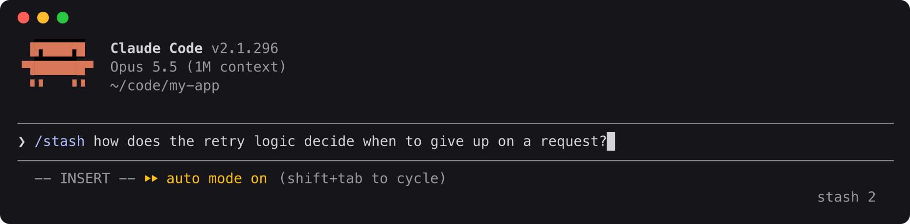
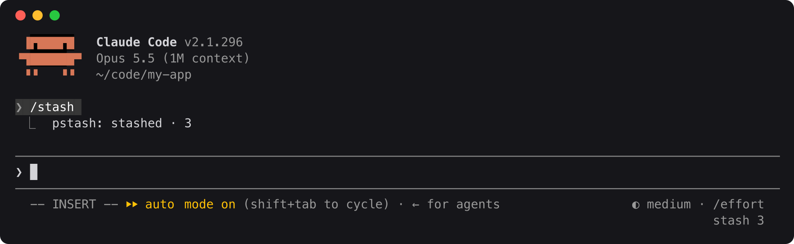
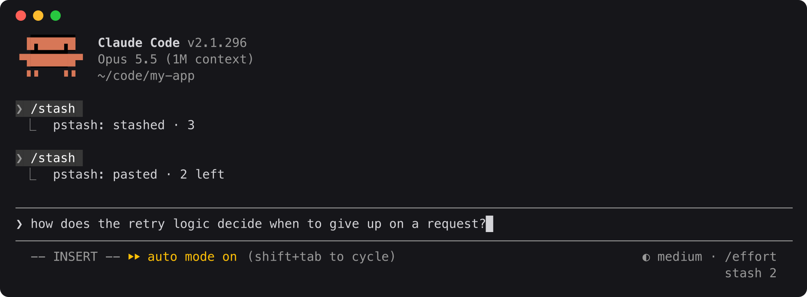
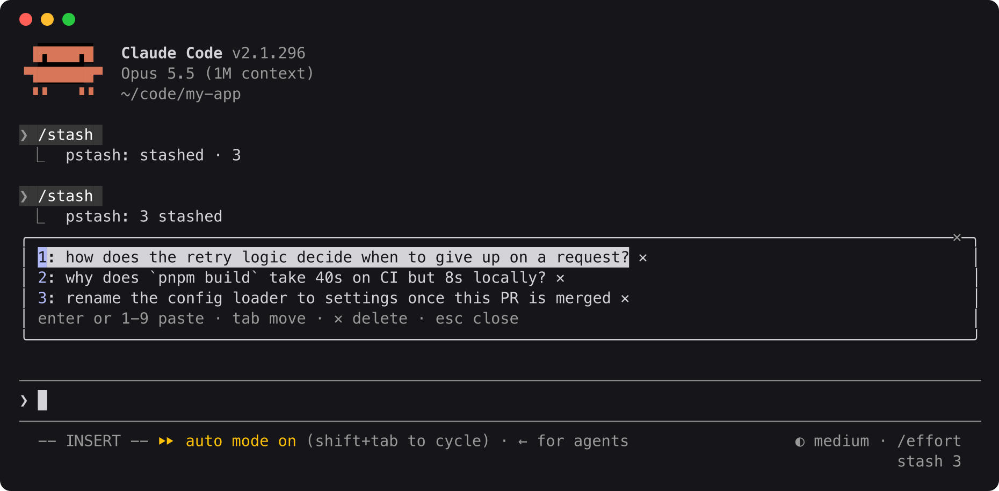

# pstash

Stash prompts for later and pop them back into the input box. A [Claude Code](https://claude.com/claude-code) mod: instant, no model call, works while Claude is busy, and the stashed text never reaches the model.

## Why not just type a follow-up?

A message you type while Claude is working is queued. Claude reads it during the current turn or right after it, so it becomes part of the work in progress. That's right for "also update the docs", and Claude often does those things anyway.

Stash is for prompts you **don't** want sent yet:

- **Side questions.** "How does the retry logic decide when to give up?" would derail the task Claude is on. Stash it and ask once the task is done.
- **Several ideas at once.** Jot down every question or follow-up as it comes to you, then send them one at a time, in the order you choose.

## Install

In Claude Code:

```
/plugin install pstash --marketplace maxsoldev/pstash
```

## Use

| Command | Does |
|---|---|
| `/stash <text>` | Saves the text |
| `/stash pop` | Pastes the newest stash into the input box |
| `/stash` | Opens the picker |

**1. Stash a prompt.** Type `/stash` and the prompt you want to send later.



**2. It's saved.** Press Enter: the prompt is stashed and the footer count goes up. The stashed text stays out of the chat and out of the model's context.



**3. Pop it back.** `/stash pop` pastes the newest stash into the input box, ready to edit or send.



**Or pick one.** Bare `/stash` lists everything: Enter or `1`-`9` pastes, Tab moves, `✕` deletes, Esc closes.



## Storage

One JSON file per project, shared by all sessions: `~/.pstash/<project path with non-alphanumerics as ->.json`. Set `PSTASH_DIR` to move it.

```json
{
  "version": 1,
  "project": "/Users/max/app",
  "items": [{ "id": "lx2k9a3f", "text": "how does the retry logic decide when to give up...", "at": "2026-10-11T14:20:00.000Z", "from": "claude" }]
}
```

Items are newest first, capped at 100, without duplicates. Each change re-reads the file, so sessions don't overwrite each other, and a file that doesn't parse is never overwritten. Any tool that follows this format can share the stash.

## Develop

```
claude --plugin-dir .
claude plugin validate .
claude plugin test .
```
