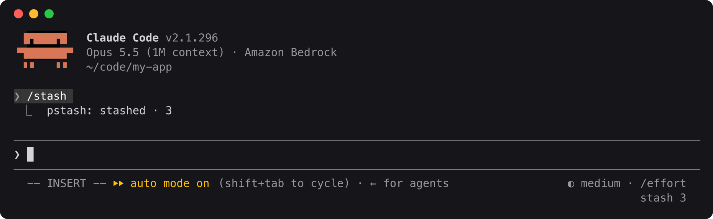
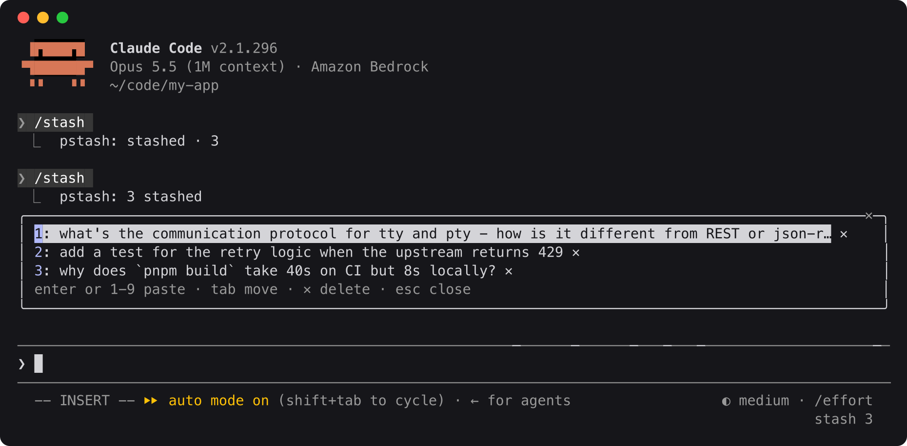
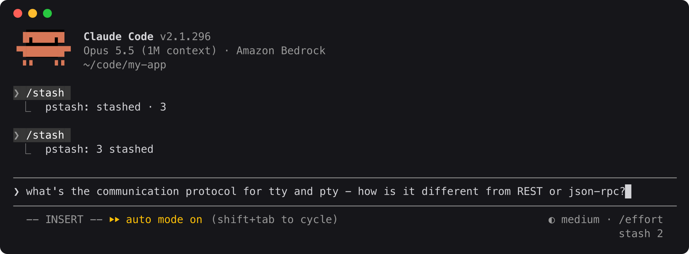

# pstash

Stash prompts for later and pop them back into the input box. A [Claude Code](https://claude.com/claude-code) mod: instant, no model call, works while Claude is busy, and the stashed text never reaches the model.



## Install

In Claude Code:

```
/plugin install pstash --marketplace maxsoldev/pstash
```

## Use

| Command | Does |
|---|---|
| `/stash <text>` | Saves the text |
| `/stash` | Opens the picker |
| `/stash pop` | Pastes the newest stash into the input box |

In the picker, Enter or `1`-`9` pastes, Tab moves, `✕` deletes and Esc closes. A paste goes in at the cursor and removes the item. The footer shows `stash n` while anything is stashed.





## Storage

One JSON file per project, shared by all sessions: `~/.pstash/<project path with non-alphanumerics as ->.json`. Set `PSTASH_DIR` to move it.

```json
{
  "version": 1,
  "project": "/Users/max/app",
  "items": [{ "id": "lx2k9a3f", "text": "what's the protocol for tty...", "at": "2026-10-11T14:20:00.000Z", "from": "claude" }]
}
```

Items are newest first, capped at 100, without duplicates. Each change re-reads the file, so sessions don't overwrite each other, and a file that doesn't parse is never overwritten. Any tool that follows this format can share the stash.

## Develop

```
claude --plugin-dir .
claude plugin validate .
claude plugin test .
```
